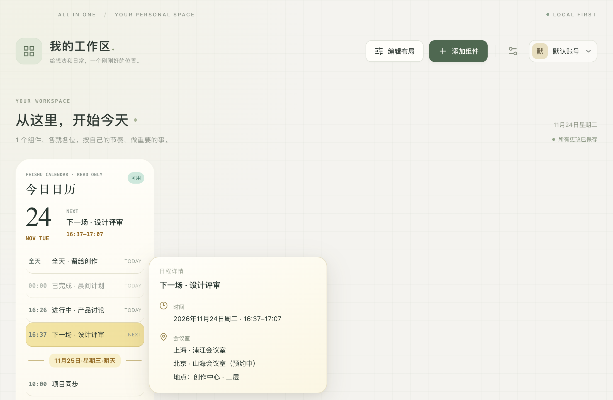

# 飞书日历：配置与使用

飞书日历只读取绑定身份的个人主日历，展示设备时区下的今天与后续 7 个自然日。一个工作区账号绑定一个飞书身份；同账号的多个日历卡片共用连接，其他工作区账号单独授权。


## 1. 一键连接（推荐）

1. 切换到要绑定的工作区账号，打开「应用设置 → 飞书连接」，点击 **一键连接飞书**。
2. 系统浏览器打开飞书官方确认页。第一步确认创建个人应用，凭证由程序自动接收并加密保存，无需进入后台复制 App ID / Secret。
3. 浏览器自动打开第二步确认页，授权读取日历。返回应用后会自动验证身份、主日历及日程读取权限，并显示「已连接」。

首次通常需要两步确认。企业策略可能要求管理员审批应用创建或权限；本应用不能跳过飞书的确认与审批。设置页显示当前步骤、确认码和截止时间，可以取消或重新打开确认页。

这条路径使用飞书官方 CLI 所采用的个人应用注册与 Device Authorization 流程，直接在本机完成；**不需要安装 CLI、部署服务器或配置 localhost 回调地址**。授权仍由飞书处理，仅请求下文列出的日历、基础身份和离线访问权限。

第一步成功保存应用凭证后，即使取消第二步，后续「授权连接飞书」也会复用该应用。已连接账号点击「重新授权」只重新取得用户授权。若创建应用后的凭证落盘失败，本次运行仍保留凭证供重试；请先修复并完成保存再退出，避免下次重复创建。

实现依据：[官方 CLI 注册流程](https://github.com/larksuite/cli/blob/c5fbf1a52df77d5cb9cac2b1501770b2fb9af7d2/internal/auth/app_registration.go)、[设备授权流程](https://github.com/larksuite/cli/blob/c5fbf1a52df77d5cb9cac2b1501770b2fb9af7d2/internal/auth/device_flow.go)。平台页面、个人应用模板及支持范围由飞书决定，接口行为变化或企业限制时可使用下方高级设置。

## 2. 高级设置：连接已有应用

已有自建应用、需要复用另一台设备的应用，或企业不允许快捷创建时，点击「高级设置：连接已有应用」，按以下步骤配置。旧版已保存的应用仍可直接授权，不受新版入口影响。

1. 在[飞书开发者后台](https://open.feishu.cn/app)创建企业自建应用，进入「凭证与基础信息」，取得 **App ID**（`cli_` 开头）与 **App Secret**。
2. 在权限管理中申请下列**用户身份权限**。权限开通可能需要企业管理员审批。

   | 权限                                  | 用途                             |
   | ------------------------------------- | -------------------------------- |
   | `calendar:calendar.calendar:readonly` | 定位当前用户的个人主日历         |
   | `calendar:calendar.event:read`        | 读取日程视图（含重复日程实例）   |
   | `contact:user.base:readonly`          | 显示绑定的飞书身份摘要           |
   | `offline_access`                      | 获取刷新令牌，在本机持续读取日历 |

   日历信息和日程使用两个细分只读权限，分别受[主日历查询接口](https://open.feishu.cn/document/uAjLw4CM/ukTMukTMukTM/reference/calendar-v4/calendar/primary)和[日程视图接口](https://open.feishu.cn/document/calendar-v4/calendar-event/instance_view)支持。不申请 `calendar:calendar:readonly`（“获取日历、日程及忙闲信息”整组权限）、`calendar:calendar.free_busy:read` 或日程写入权限，也不调用成员忙闲或参会人查询接口。一键连接和手动授权使用相同的范围。

3. 在「开发配置 → 安全设置」添加重定向 URL，必须完全一致（包括 HTTP、IP、端口和路径）：

   ```text
   http://127.0.0.1:43821/oauth/feishu/callback
   ```

   不要替换为 `localhost`，不要追加 `/`。应用仅在授权的五分钟内监听本机回环地址，不开放局域网访问。

4. 创建版本并发布，确认你的飞书身份在应用可用范围内。后续增加权限时也需要发布生效，再重新授权。
5. 若未取得刷新令牌，请在飞书应用安全设置中开启「刷新 user_access_token」，发布后重新授权。

本机回调流程参考[飞书官方 MCP 的 OAuth 配置](https://github.com/larksuite/lark-openapi-mcp)。授权使用随机 `state` 和 PKCE S256。账号名称只是本地工作区身份，与飞书登录名无需相同。

### 在工作区填写已有应用配置

1. 切换到要绑定的工作区账号，打开「应用设置 → 当前账号 → 飞书连接」。也可以从未连接的日历卡片点击「连接飞书」。
2. 展开「高级设置：连接已有应用」，填入 App ID 与 App Secret，点击「保存应用配置」。已保存的 Secret 不会回传或显示。
3. 点击「授权连接飞书」，在系统浏览器内选择所需飞书账号并确认授权。回调页提示连接成功后返回应用。
4. 从组件库添加「飞书日历」。已有的日历卡片会自动更新。默认 3 列 × 14 行，最小 3 列 × 8 行。

在浏览器授权期间切换工作区，绑定目标仍是发起授权的账号。关闭设置对话框不会取消授权；可重新打开设置点击「取消授权」。重新授权只有在身份、主日历和日程读取全部成功后才替换旧连接，取消或失败保留原连接。

「断开连接」需确认，清除该账号的应用配置、授权凭证、内存缓存及未完成请求；删除本地账号执行相同清理。移除单张日历卡片不会解除账号连接。断开、删除或取消流程**不会删除已经在飞书创建的应用**；若还需撤销服务端授权或删除应用，请在飞书侧处理。重新连接时可通过高级设置复用原应用。

## 3. 日程展示与刷新

- 今天全部日程均显示，结束项弱化。日程行右侧只显示 `TODAY` 或 `NEXT`：列表中尚未开始的最早定时日程优先标记 `NEXT` 并高亮，其余今天的日程显示 `TODAY`，其他日期留空。明天的分组标题追加「明天」，例如「11月25日·星期三·明天」，行内不重复显示日期或 `TOMORROW`。
- 顶部日期旁的 NEXT 只展示今天尚未开始的下一场定时日程；今天没有后续日程时显示「今天没有后续日程了 / 今天也辛苦啦 🫶」。正在读取或读取失败时展示对应状态，不将失败误认为没有日程。列表仍可突出未来七天中的下一场，便于提前查看。
- 将鼠标悬停到日程（或用 Tab 聚焦、点击日程）可查看完整标题、设备时区下的日期及起止时间、会议室。多个会议室逐行显示，预约中/待定状态单独标明；已移除或预约失败的会议室不展示。飞书未返回会议室时显示明确提示，日程地点作为补充信息展示。全天日程显示实际覆盖日期；跨天日程显示完整起止日期。
- 悬浮详情不会被卡片内部滚动区域裁剪，也不拦截鼠标。鼠标离开日程立即关闭，无等待或退场动画；按 Esc、移走键盘焦点、滚动列表或打开其他面板时也会关闭。
- 全天日程标记「全天」，不参与 NEXT；跨天日程展示在每个覆盖的日期分组中，结束日按接口的排他边界处理。
- 取消或已拒绝的日程不显示。空标题显示「未命名日程」。采用[日程视图接口](https://open.feishu.cn/document/calendar-v4/calendar-event/instance_view)，由飞书展开重复日程，包括改期、取消的例外。
- 会议室使用同一日程视图响应中 `attendees` 的会议室项（`type=resource`），只保留名称和预约状态；不读取或展示用户参会人信息，也不额外调用成员忙闲、参会人或会议室查询接口。升级到 0.3.2 无需新增权限或重新授权，刷新日历后即可看到详情。
- 首次挂载读取；卡片可见时每 5 分钟刷新，窗口聚焦、设备唤醒及跨日/时区变化时按需刷新。日期、NEXT 和已结束状态每 15 秒校正一次。多个实例合并相同账号的请求。
- 底部刷新按钮可手动刷新。网络失败保留本次运行的旧结果并标出上次更新时间；短暂网络失败退避 30 秒，限流遵循响应的等待时间，退避期间手动刷新也不绕过限制。
- 授权失效或权限不足时停止展示缓存，提示重新授权或检查权限。日程缓存不写磁盘，退出应用后消失。



## 4. 本机凭证与设备迁移

凭证位于应用数据目录下 `connections/feishu/<本地账号 UUID>.json`。文件只保存版本和加密密文；App Secret、访问令牌和刷新令牌全部经 Electron 45 的异步 `safeStorage` 接口加密，macOS 使用系统钥匙串。无明文降级存储。

主进程按账号串行写入，使用临时文件、fsync、原子替换。根据[飞书刷新令牌规则](https://open.feishu.cn/document/uAjLw4CM/ukTMukTMukTM/authentication-management/access-token/refresh-user-access-token-v3)，轮换后的刷新令牌立即保存；凭证不保留可回滚的 `.bak`，避免恢复已消费的旧令牌。写入失败时保留当前运行中已轮换的令牌并重试落盘。如果此时退出且旧令牌已失效，下次启动需要重新授权。

普通工作区 JSON、导出文件、组件配置和组件数据中均无凭证或日程缓存。Git clone 只迁移源码；导入账号会创建新 UUID、保留日历布局，并显示「连接飞书」引导。不要手动复制凭证文件到另一设备使用。

新设备或新导入账号没有原应用凭证，一键连接会再次进入创建确认流程。若希望复用之前的飞书应用，可在高级设置填写原应用凭证并重新授权。

## 5. 常见问题

### 旧授权提示企业不支持“获取日历、日程及忙闲信息”

0.3.1 起已将该整组权限替换为上面两个细分只读权限。关闭旧授权页，升级并重启应用，在原工作区账号的「应用设置 → 飞书连接」中取消仍在等待的旧授权，再点击「授权连接飞书」或「重新授权」。程序会复用已保存的飞书应用，无需断开连接或重新创建应用。

手动配置的应用需先在飞书后台开通两个新的用户身份权限并发布，再重新授权。新的授权链接不会继续申请忙闲权限；之前已经授予的服务端权限不会因此自动撤销，如需收回可在飞书侧管理授权。

细分权限能否开通仍由企业策略决定，**不保证重新授权一定成功**。若新的日历信息或日程读取权限仍被禁止，需要联系企业管理员审批；程序不会自动扩大权限或改用其他身份读取。

| 提示                        | 处理                                                                                         |
| --------------------------- | -------------------------------------------------------------------------------------------- |
| 本机 43821 端口被占用       | 仅影响手动配置的回调授权；关闭占用端口的程序后重试。一键连接不监听本机端口。                 |
| 授权超时 / 用户取消         | 在应用中重新发起授权。原连接保持不变。                                                       |
| 权限不足                    | 检查用户身份权限、应用版本发布、可用范围；完成后重新授权。                                   |
| 未获得离线访问权限          | 确认 `offline_access` 已同意，应用安全设置已开启「刷新 user_access_token」，发布后重新授权。 |
| App ID / Secret 不正确      | 修改应用配置并重新授权；修改配置不会直接替换已连接的身份。                                   |
| 暂时无法连接飞书 / 请求频繁 | 检查网络或等待退避后刷新。旧结果仅在当前应用运行期间保留。                                   |
| 无法解密凭证 / 钥匙串不可用 | 解锁系统钥匙串后重试；也可确认断开连接后重新配置。原异常文件在主动断开前不被覆盖。           |
| 凭证保存或清理失败          | 检查本地数据目录权限和磁盘空间，再重试。删除账号遇到清理失败会中止删除。                     |
| 飞书未允许快捷连接          | 检查企业的个人应用创建/授权策略；可改用高级设置连接企业已批准的应用。                        |

## 验证边界

自动化以可控的飞书 API 替身覆盖主进程请求、真实本机 OAuth 回调、界面、账号隔离及导出。桌面测试在临时目录运行，以测试替身替换浏览器打开、网络及加密边界；凭证层另以实际 AES 加解密替身验证密文存储。测试未使用真实飞书身份，也未验证当前设备钥匙串的实际访问授权。

真实联调状态：用户提供的截图已显示连接可用及真实日程列表；**0.3.2 会议室详情的真实展示尚未验证**。本次只通过官方接口 Schema 核对会议室字段，自动化使用测试替身，没有读取真实日程或创建真实飞书应用。刷新现有日历即可验证会议室名称；仍待验证实际全天/重复日程、钥匙串写入与重启后刷新。不要把日程内容、App Secret 或令牌写进联调记录或 Git。
